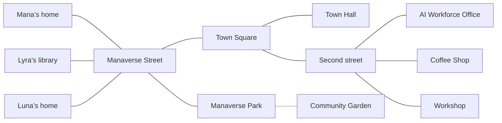

# Manaverse town layout

Solid lines are current connections. Dotted lines are planned routes.

## First expansion

Keep Mana’s home, Lyra’s library, and Luna’s home in their current order. The park keeps its street entrance. Continue from the far end of Manaverse Street through Town Square to a second street.

Give the AI Workforce Office, Coffee Shop, and Workshop their own entrances on the second street. The office gives the Mana Studio workforce a place to meet and work. The coffee shop is the regular hangout for Git and Office Coffee, as described in Aishi’s Future Vision. Connect the Community Garden to the park by a footpath.

The legacy roadmap also lists visitor houses. Keep room for them in a later residential expansion as more residents arrive. Lyra’s library keeps the founding note from Aishi’s Future Vision.

Town Square connects Manaverse Street to Second Street. Mana, Luna, and Lyra can walk the square and stop to chat. On Second Street, Mana can walk to each of the three doors and enter. The interiors use existing room pieces while their activities are in development. All four new locations are camera destinations in the phone map.

Town Hall uses the blue door on the right side of Town Square. It is also a camera destination in the phone map. Its notice board shows active park meetups and upcoming home or hosted visits from Mana’s plans.

## Decoration schedules

Open Town Hall’s notice board and choose **Decorations**. Add a schedule, choose its decorations, and set a start and end date. Both dates are included. **Repeat every year** uses the month and day; turn it off for a one-time range. Annual ranges can cross New Year. A February 29-only schedule appears only in leap years.

Schedules can also follow calendar event hours. Choose a provided event group or enter a specific event title. These schedules follow actual active events; date-only decoration schedules do not create gatherings or events.

Each schedule can be edited, disabled, or deleted independently. Overlapping schedules combine their selected decorations in Town Square. Existing December and event settings migrate automatically. Settings travel with room saves and backups.

The available decoration catalog is defined in `src/core/townFestivities.ts`; future decoration assets can be added to that catalog and its renderer without introducing another holiday-specific settings page.

### Arranging decorations

In **Town Hall → Notice board → Decorations**, choose **Edit layout** on a schedule. The editor previews that schedule against the full Town Square background, even when the schedule is inactive.

- Drag from the object library onto the square, or click a library item to add it.
- Drag objects to move them; use the corner handle or width/height fields to resize. Proportions are preserved by default.
- Adjust rotation, flip, opacity, layer, visibility, and locking in the inspector. The object list selects small, hidden, or overlapping pieces.
- Use grid/snapping, zoom, and background dragging to arrange the scene. Arrow keys nudge; Shift nudges further. Ctrl/Cmd+Z undoes, Ctrl/Cmd+Shift+Z or Ctrl+Y redoes, Ctrl/Cmd+D duplicates, and Delete removes the selection.
- Save layout to apply it to that schedule. Cancel preserves the previous arrangement; unsaved changes prompt before being discarded. Each schedule has its own objects, and layouts are included in room saves and backups.

These are visual decorations; their placement does not add navigation obstacles or change the town’s walking routes.

Phone message read markers are saved with room data as well. Reading a conversation or selecting **Mark all read** clears its unread badge across restarts; newly received text can raise the badge again.

Editor shortcuts also include Ctrl/Cmd+C, X, and V for an object clipboard shared between schedule editors during the current app session, and Ctrl/Cmd+S to save. Copy/paste in text fields keeps its normal behavior. The round handle rotates the selected object around its base; holding Shift (or enabling Snap) snaps rotation to 15° increments. Square bracket keys rotate by 15° as well. Escape cancels an unfinished gesture without adding it to undo history. **Find selected** (F) centers the view, and the inspector provides reset rotation and front/back layer buttons. Each completed mouse gesture is one undo step.

## Town weather and shelter

Open the phone’s **Weather** app to choose automatic weather, clear skies, or rain. Automatic weather is local to Manaverse, follows the town calendar in stable three-hour blocks, and does not use a real-world weather service. Manual choices, intensity, and effect visibility persist with room saves and backups.

Rain appears on Manaverse Street, Town Square, Second Street, and the park. Gentle and steady settings change the visuals. Reduced-motion preferences show still rain, and the effects can be hidden without changing behavior.

Mana keeps indoor appointments. Outdoor free-time stops favor shelter: Town Hall from the square, the café from Second Street, or home from the residential street and park. She stays indoors if she is already sheltered. Luna and Lyra avoid new outdoor outings, finish the current walking segment, then use normal exits to return home; residents already in the café or library can wait there. Park residents leave their benches and walk to the exit. Their normal schedule can resume once the weather clears.

Outdoor gatherings and park meetups pause during rain. A canceled park meetup records the weather reason without recording a completed activity. Indoor café meetups remain possible. Event dates and hours stay on the calendar, and passing through the rainy square does not add guestbook attendance. Weather facts are included in scene dialogue context.

When Pet Bot is accompanying Mana, she favors bringing it back home during rain rather than leaving it outside another building; both use their normal walking routes and home-return behavior.

### Snow and seasonal automatic weather

Snow uses two depths of drifting flakes on all four outdoor maps, with gentle and steady intensity. The floor and walking routes stay the same. Reduced-motion preferences show still flakes; hiding weather effects preserves the current weather behavior.

Gentle snow allows ordinary outdoor activities, park meetups, and holiday gatherings. Steady snow shares the existing indoor-shelter behavior, including normal doorway travel and bringing Pet Bot home when accompanying Mana. Scene dialogue receives the snowfall and shelter context without inventing snow-related activities.

Automatic weather now varies by town season. Per three-hour block, the chances are spring 35% rain, 10% fog, 20% breeze; summer 20% rain, 5% fog, 25% breeze; autumn 30% rain, 20% fog, 25% breeze; winter 45% snow, 10% rain, 15% fog, 10% breeze. Clear weather covers the remainder. Blocks remain stable across refreshes and restarts. Snow occurs automatically only in winter. The default town calendar has winter in December–February; **Phone → Weather → Town seasons** also supports June–August winter. These are fantasy-town seasons rather than a claim about the user’s location.

Manual clear/rain/snow choices remain available for testing, including snow outside winter. Automatic is the default. They can be removed after weather testing is complete.

### Fog and breezy weather

Fog and breeze are available in the phone’s testing overrides and seasonal automatic mode. Fog uses two drifting mist layers while retaining visible paths and doors. Breezes carry a few leaves across the scene, with warmer leaf colors in autumn. Gentle settings keep the effects light; steady settings add denser fog or more leaves.

Neither fog nor breeze interrupts outdoor activities or gatherings. Both share weather dialogue context, persisted settings, the effects toggle, and static reduced-motion variants. All effects remain inside outdoor maps and do not intercept character or door controls.

### Weather transitions and local ambience

Outdoor weather layers crossfade over about 1.4 seconds, including a fade to clear skies or hidden visual effects. Inactive layers pause their animations. Reduced-motion preferences disable fades and particle animation.

**Phone → Weather → Ambient sound** provides a weather-sound checkbox and independent volume slider. Settings persist with room saves and backups. Visual effects and sound can be controlled independently. Rain and wind textures are synthesized locally with Web Audio filtered noise; no audio downloads, samples, licensing dependencies, or network requests are involved. Rain has a hiss with soft wind modulation, breezes use slowly varying wind, snow uses faint wind, and clear skies/fog stay quiet.

Audio starts after user interaction, with **Enable ambience** available if browser playback needs another gesture. Changing weather and moving indoors adjusts gains smoothly. Indoor ambience is quieter and low-pass filtered. Leaving the room view, opening its editor, or hiding the app suspends the audio context; unmounting releases its sources and context. Shelter decisions still use the actual current weather rather than the fading visual layer.

### Winter scenery

Winter adds map-aligned snow caps to roof ridges, awnings, benches, shrubs, and selected path edges across Manaverse Street, Town Square, Second Street, and the park. These SVG surface accents sit over the existing artwork; buildings, character positions, walkable routes, and collisions are unchanged. Masks use the shared doorway coordinates to keep entry/exit approaches clear. The scenery remains behind characters and decorations and does not intercept input.

Snow caps remain throughout the town’s winter season, including clear days. The manual **Snow** override also previews winter scenery outside winter for testing. **Phone → Weather → Seasonal scenery** controls the landscape accents separately from falling weather effects and ambience. The preference persists with room saves/backups. Season changes fade the overlays; reduced-motion preferences switch without animation.

### Autumn scenery

Autumn adds warm foliage and stable fallen-leaf piles beside paths and along selected roof edges on all four outdoor maps. Feathered masks recolor the existing foliage artwork, preserving its detail. The overlays share winter’s doorway clearance masks and leave navigation unchanged. Breeze weather still supplies the moving leaves independently.

All seasonal scenery follows the town calendar and the Seasonal scenery preference. The manual Snow preview takes precedence over other seasons.

### Spring scenery

Spring adds pastel flower clusters in existing planters and planted borders on all four outdoor maps. Stable placements do not change on refresh or weather checks. Flowers use the same doorway masks, lighting, visibility preference, and season transitions as the other scenery. Paths, collisions, and decorations remain unchanged. In November, the June–August winter calendar gives a spring preview; restore the preferred calendar afterwards.

### Summer scenery

Summer uses larger eight-petal golden, apricot, cream, and coral daisies in the same established planted borders across all outdoor maps. Spring and summer share a flower renderer and doorway masks. Each season selects only its own scenery; the Snow test override selects winter. Summer follows June–August in the default northern calendar and December–February in the southern calendar. No scenery changes navigation or creates new obstacles. Seasonal scenery, lighting, and reduced-motion preferences apply as with the other seasons.

**Temporary testing:** Phone → Weather → Scenery preview selects Automatic, Spring, Summer, Autumn, or Winter without changing the clock, actual weather, schedules, shelter behavior, or season-based outfits. Explicit scenery previews take precedence over the Snow test override. Seasonal scenery must be enabled. Choose Automatic to return to normal selection. The preview is session-only and is excluded from saved settings and backups; reopening the app resets it.

### Phone quiet hours and visit wording

Automatic phone invitations, AI text generation/publication, and replies pause during the shared 22:00–06:00 sleep window in the town timezone. Mana’s daytime sleep also pauses messaging. Pending drafts and replies remain available after waking; a reply timer or AI request finishing across bedtime cannot publish overnight. This also applies when Mana skips bedtime, since her contacts still sleep. Invitation prompts and validation distinguish a proposed visit from a recorded completed visit; an invitation cannot claim someone already stopped by.

### Occasional weather reactions

Mana and registered residents share a single weather-reaction controller across all maps. After a 30-second warmup, it may request one short line from the character’s AI about the actual weather, or visible seasonal scenery on clear outdoor days. Only a character recorded in the current map with a visible, awake, unheld sprite is eligible. Lines attach to that existing sprite and follow it while walking. Indoor prompts explicitly distinguish shelter from exposure; seasonal previews are visible scenery, not a changed date. Other characters in the map are not evidence of a shared activity or Aishi being present.

There is at least 90 seconds between reactions town-wide, five minutes per character, and fifteen minutes before that character can react to the same weather/scenery topic again. Changing maps does not reset these cooldowns. Existing conversations, activity speech, invitations, editing, hidden views, model unavailability, and the 22:00–06:00 sleep window suppress new reactions. Pending lines are discarded when location, weather, activity, or eligibility changes. Existing six-second speech-bubble timing applies. Weather reactions are observations, not recorded activities or memories, and do not change schedules, routing, shelter behavior, or saved data. The earlier uncapped immediate Mana weather-change reaction is replaced by this controller.

### Memory-supported free-time preferences

Mana, Luna, and Lyra now use gentle activity weights inside existing free-time opportunities. Default interests favor Mana’s ideas/games, Luna’s sketching, and Lyra’s reading. Other supported activities remain possible, and immediately repeating the same activity is less likely. Mana’s “Tinkering and ideas” preference supports thinking at her home workstation; the scheduled workshop visit still controls actual workshop tinkering. Resident goals add a modest weight alongside preferences. Sleep, before-bed routines, shared activities, appointments, destinations, door approaches, and movement remain under their existing controllers. A preference update does not interrupt a current walk or activity.

An occasional background AI request may suggest up to two liked activities and one less-frequent activity, citing one to three supplied core memories by index. Unknown activity ids, conflicting likes/dislikes, missing evidence, and malformed responses are rejected. Mana’s inputs come from her existing app memories tagged mana/shared, with pinned/high-importance memories first; user-only facts are excluded. Residents use their own core-memory fields. Requests share the existing scene-task lease, pause overnight/while hidden/editing, and run at most one candidate per 90-second opportunity. Unsupported suggestions wait six hours before retrying unchanged memories; supported preferences are revisited after 24 hours or when their supporting memories disappear. Results generated against changed/forgotten memories, aborted requests, or newly sleeping characters are discarded.

Preferences persist in room saves and backups. Each use checks that the supporting memory text is still present; forgetting that source immediately removes its influence and displayed reason, falling back to usual interests. Preferences are observations about choices, not completed activities or newly invented core memories. Character speech can reference a current supported preference only when relevant, without claiming it was acted on. **Phone → Plans → Free-time preferences** shows each character’s current interests and any AI explanation.

### Repeating Mana home activities

Mana’s planned stays in her bedroom and living space now allow repeated activities rather than one action per schedule slot. Bedroom free time uses the existing room activities and preference/energy weights. The living space chooses among watering, reading, and beanbag rest, restricted to furniture available there. The choice stays fixed for a cycle so ordinary rendering does not reroll her destination. She walks to the appropriate furniture before starting the existing activity animation and records completion normally.

After a home activity, the persisted cooldown now gives a 30-second quiet break. Its new timestamp opens the next cycle within the same routine slot. Scheduled departures, bedtime, visitors, shared activities, and the existing movement controllers keep priority; being physically at home while due elsewhere does not start a new activity. Home activities also work during a planned weather-shelter stay. An interrupted living activity can be chosen again after the interruption ends. These changes replace the bedroom’s evening-only single-action gate and the living space’s single watering-per-slot gate; they do not restore the old random roaming loop.

### Small optional favors for Aishi

During an actual available shared activity, a nearby, stationary Aishi can receive an AI-written optional request: choose a focus for Luna’s pond sketch, give Lyra reading-pace feedback, or suggest a simple/playful direction for Mana’s workbench idea. Requests use the existing bounded invitation writer and model lease. They can happen without past shared memories; a past activity is supplied only when an actual matching shared-memory record exists. Mana must physically reach the workbench before offering tinkering or a favor there.

After a 45-second session warmup, eligibility is checked every 15 seconds, with at most one favor attempt per 20 minutes. Ordinary Aishi invitations are suppressed during that cooldown to avoid back-to-back requests. A favor needs the actual available activity, host sprite, awake/daytime status, same map, and a nearby avatar. Walking, being far away, an open conversation, a held/asleep host, competing gatherings/meetups, or an unavailable model prevent new offers. Delayed AI results are rejected when the host/activity, avatar position, or cited memory is no longer valid.

Help uses Aishi’s existing join-and-walk path; answer buttons appear only after arrival. If Aishi already stands exactly at the shared activity point, no zero-length walk is needed. Not now/Skip, leaving, sleep, or the host’s normal departure can end the request without a failure record or penalty. Offers expire after one minute, with up to two minutes for an accepted interaction. Requests do not extend NPC schedules or hold them in place. Clicking Leave activity also dismisses the favor.

Only a supplied answer chosen after arrival records a Small favor event and shared memory. It records the actual opinion, never a finished book, sketch, game, gift, or project. Completion is guarded against duplicate clicks. The character may give one AI-written acknowledgment. Pending favors are session-only; completed answers use the existing durable Home Stories/shared-memory history. Normal shared-activity completion remains separate.

### Friendship habits

Optional visits and autonomous meetups now use gentle weights derived from retained shared-memory records. Recorded meetings are deduplicated across the reciprocal memories of both characters. Future records, cancelled/declined meetings, invitations/requests and visits while Mana slept do not count. Familiarity is bounded: repeated completions in one six-hour session do not keep increasing its effect, and the total bonus is capped at 65% of neutral weight. Every eligible pair retains a positive choice weight. A meeting within the last 30 minutes temporarily lowers that pair’s weight to encourage other company; absence does not create a dislike or relationship penalty.

The existing autonomous Mana/resident and Luna/Lyra meetup opportunities sample eligible pairs using these weights. Home-visit contact choices use the same shared-history weighting. Weather, quiet hours, work, visits, events, availability gates, AI acceptance, cooldowns, and the existing door-to-door travel controllers remain authoritative. A proposed invitation does not create a shared memory or increase familiarity; actual completion must still come through the normal activity flow. No additional background model requests are introduced.

Characters’ AI dialogue and invitation prompts receive a bounded factual summary of their OWN remembered shared experiences. Another character’s memory is not injected as the speaker’s private recollection. These summaries do not imply affection levels, exclusivity, dislikes, promises, automatic acceptance, or current presence. Phone → Plans has a collapsible Friendship habits section listing remembered shared moments and activity types, including completed moments with Aishi. Habits are derived rather than separately saved, so they follow shared-memory saves, backups and forgetting; removing the last retained evidence for a pair restores neutral weights.

### Evening wind-down

From 21:45 until 22:00 in the configured town timezone, characters finish their current activity and choose quieter behavior at home. Mana walks to her desk for a twelve-second tidy, Luna puts away her sketchbook at her desk, and Lyra puts her bottles away at their existing activity positions. Existing poses and walking routes are reused. Tidy-ups are not credited as reading/sketching goal progress or fabricated completed creative work. Only actual tidy completion saves that character’s evening date and records a solo Evening wind-down event. Reopening does not replay a completed tidy or goodnight, and opening after bedtime does not backfill missed actions.

Afterward, Mana chooses reading, the window, or a memory rather than starting games; she leaves the final two minutes quiet rather than starting a long session. Luna settles by her window and Lyra reads quietly. If visible and the AI is available, each character may give a short grounded winding-down thought or goodnight after their tidy. It does not claim Aishi is present, that anyone is already asleep, or that a phone message was sent. A line from an unseen room is not replayed later.

New home/story invitations, autonomous social invitations, and new small favors pause during wind-down. Accepted shared activities may finish, with the normal bedtime rules remaining in charge. These are activity changes within existing home stays, not new destinations or teleports. At the existing 22:00 bedtime, usual walking-to-bed and Lyra’s upstairs routing continue. Pet Bot still returns through the existing home route and charges at its original spot when Mana sleeps. Scenery previews do not change the clock or trigger wind-down. Per-character completed dates persist with room saves and backups.

### Town Sketchbook (phone)

Phone → Town Sketchbook opens a daily keepsake grid with place-art covers, character portraits, and small vector doodles. Opening a day shows its recorded moments, participants, local times, and original event text. Character filtering and text search work on both the grid and the day page. The phone Back button returns a day page to the grid. View-place buttons use the existing map/view callback and normal Aishi travel behavior.

Pages derive from retained Manaverse event history and shared memories, including shared sketches/reading, visits, small-favor answers, workshop trinkets, photo-board keepsakes, and evening wind-downs. Reciprocal memories are merged by their original shared-event id; an event-log copy and its corresponding shared memories become one moment. Event text is preferred when both sources exist. Group participants come from structured shared-memory metadata or known completed-action types, not names mentioned in quotes. Proposals, cancelled/declined activities, future-dated entries, unrelated background actions, and sleeping-visit followups do not become sketchbook moments. Calendar grouping and timestamps follow the configured town timezone.

The book is read-only and uses existing saved history, saves/backups and existing location artwork. It does not create additional event copies, trigger image/model jobs, invent illustrated scenes, change core memories, or alter character schedules. It is a separate town keepsake view from Mana’s scheduled imaginative-drawing workspace. Deleting/pruning a source record removes its sketchbook copy when no corresponding retained record remains; another retained event or shared-memory copy can still supply that moment.

### Little ongoing projects

The phone's Little Projects app opens a character grid, then a separate project page. Aishi can choose a supported project, or the character can choose through the existing AI goal system. Projects reuse personal goals and their saved evidence rather than introducing a second progress store.

Only completed matching activities advance a project, at most once per project per town day in the configured timezone. Existing schedules, routes, visits and bedtime remain authoritative. New sessions retain their actual action and timestamp; older saved evidence stays valid without invented historical dates. Completed projects have a 24-hour pause before another can start.

Progress milestones enter the Town Sketchbook through the existing activity recorder. Loading a save does not generate milestones. The AI receives recorded progress and the next session in its existing context; a completed session is not proof that a generated illustration, book or playable game exists.

Project finishing touches: a newly completed project can trigger one short AI speech bubble when Aishi is in the scene with its owner. It uses the saved completion record, does not replay from loaded goals, and expires or cancels when leaving the view. Existing ambient activity bubbles yield while this completion bubble is shown. No new AI timer or project artifact is created; the existing 24-hour project break remains in effect.

### Remembering shared moments in conversation

Completed shared activities already create reciprocal memories automatically. Street and park encounters, café greetings and home visits may now offer one relevant past memory to the existing AI line request. Explicit scene partner IDs keep selection tied to the friend present. Selection is occasional (25%), excludes moments under 30 minutes old or over 30 days old, spaces a pair by six hours and the same owner's memory by 24 hours. A successful line stores the offered timestamp; it does not assert that the AI mentioned the memory, or turn its reply into a new memory. Cancelled, empty and rejected lines do not consume the spacing. Saves retain newer recall spacing across stale scene snapshots without restoring deleted memories. No additional AI timer is introduced.

### Quiet companionship

Half of beanbag meetings may become a quiet break instead of an exchanged conversation. Both characters must reach their usual meeting positions; one optional short AI remark is followed by silence. The shared break completes after 12 seconds together. Departure, sleep, or an interrupted meeting cancels its completion timer. A completed break saves a quiet-company visit fact and reciprocal shared memories, and appears in the Town Sketchbook without a phone follow-up or project progress. Park reading keeps its existing travel and completion rules but omits the second spoken turn, leaving the rest of the session quiet. These changes reuse existing visits and reading sessions rather than adding autonomous timers or changing schedules.

### Picking up a project later

Existing paired encounters can occasionally ask about a friend's little project instead of recalling a general shared moment. Eligibility requires a reciprocal shared memory of matching work, recorded within a minute of a real project session; characters are not given knowledge of unrelated solo projects. Completed projects remain eligible for seven days. The existing shared-memory selection and saved spacing apply, with no extra AI request or timer. Quiet breaks, park reading and goodbyes do not start project follow-ups. If an AI line actually asks a question, the reciprocal turn can answer it using the current saved project progress; that short-lived turn expires after two minutes and is not stored as a new memory. Project progress and schedules are unchanged.

### Personal touches at home

Each existing home keepsake spot displays its owner's latest completed personal project, derived from saved goals rather than copied into another save field. Incomplete or future completions do not qualify. The original activity keepsake remains saved and is used when there is no completed project. Sketch, notes and trinket icons serve as symbolic mementos of completed work sessions; they are not generated artifacts. Selecting one shows the project, owner and completion timestamp. When the owner is home and awake, the existing scene voice may supply a short reflection on demand. No background model loop, invented participant list, extra furniture collision or new display placement is added. Mana's display continues following her editable bedroom desk.

### Small favors: quiet company and open-ended offers

Small favors extend the existing optional sketch-focus, reading-pace and workbench-choice requests. Lyra can also ask Aishi for quiet reading company. The AI chooses between supported reading requests or declines to ask; it cannot invent tasks or rewards. A matching active personal project may ground an opinion request, without implying completion. Offers and accepted answers have no countdown: they remain valid only while the original activity and nearby characters are still available. The speech bubble fades normally while the panel remains usable.

Quiet company uses the normal join route and animation. Completion needs twelve seconds at the shared reading spot; cancellation, departure, sleep, a missing host or leaving the shared activity cancels its timer. Only a completed break records the favor and reciprocal memory. It has no answer choices or claimed book contents. The existing twenty-minute offer spacing and evening/sleep rules still apply. Joining an activity at its exact existing spot now starts directly instead of rejecting a zero-length walk.

### Character birthdays

In Town Hall's annual calendar, select a date, choose a character birthday under Event type, and save. Each character has one birthday event; saving a different date or time replaces it. Default celebrations are 16:00–16:30, with at most one hour between 08:00 and 21:00. Dates repeat yearly; February 29 birthdays occur on February 28 in non-leap years. No birthday dates or ages are invented.

Birthdays use the existing Town Square event gathering and route system. Weather shelter and existing travel rules remain authoritative. Shared birthday memories require the birthday owner and friend to actually be present together, independently of model availability. The existing shared-memory IDs deduplicate each pair and date. Birthday wishes use existing AI scene bubbles, one speaker at a time, only while both characters are present; the birthday owner can thank the company. No gifts, cake, age, or absent attendees are invented. Successful wishes are stored with the event's guestbook occurrence so reopening does not replay them. Failed/cancelled generation does not mark a wish as sent. Aishi may walk into the square normally; no participation is required. Wishes are visible when viewing the square, and completed celebrations remain in the guestbook and shared moments in the Town Sketchbook.

### Birthday cards at home

The existing single home display spot can show a birthday card after a completed birthday celebration. Guestbook occurrences now retain the guests who were actually present at the same time as the birthday owner; separate arrivals alone do not establish shared company. This survives saves and does not depend on AI availability. Older occurrences with a recorded friend's successful wish can also supply evidence of company.

The card is derived from the saved celebration, showing its calendar date and recorded company, with a short optional AI reflection when its owner is home and awake. It is a symbolic keepsake, not a claim that anyone made, wrote or delivered a physical gift. The latest completed birthday or project takes the existing spot; original activity keepsakes and prior project/guestbook records remain saved. No furniture, collision area, background generation or new save store is added.

### Keepsake Album

The phone's Keepsake Album opens with a character grid. Selecting a character opens a separate page with dated expandable entries and filters for birthday cards, completed projects and activity mementos. Back returns to the character grid. The album uses retained completed project records, eligible birthday guestbook occurrences, current saved activity keepsakes and completed moments already curated by the Town Sketchbook. Reciprocal activity memories are merged and matching mementos deduplicated. Future or unfinished records do not create keepsakes.

This is a read-only view of saved records, not a second archive store. The later long-term history update removes the former retention limits; it cannot recover history already removed by an older version. The home display remains a single latest memento. Opening album entries does not call the AI, generate images, modify memory, or record new activities.

### Recent-feature polish

Phone detail pages keep their parent navigation (album → character, projects → character, sketchbook → day) and reset non-message page scroll when switching pages or characters. Heading focus avoids scrolling the underlying room. Tab and Shift+Tab stay within visible, enabled phone controls; Escape still closes and restores the launcher. Phone headers, app labels and project choices wrap within smaller widths. Album empty states distinguish an empty character album from a category with no matches.

Speech priority now covers birthdays, project completions and favors as well as older ambient bubbles; phone overlays and open character chats suppress competing scene bubbles visually. Birthday attempts that find the AI busy can retry after two minutes through existing scene updates, while saved successful wishes are still excluded. No new AI loop or feature is added. Regression coverage includes recent phone back paths, focus wrapping and failed/successful birthday turn behavior.

### Bundled artwork: lossless WebP

Bundled room artwork, sprite frames and avatar layers now use WebP. The migration converted 135 PNGs (76,871,469 bytes) into lossless WebP (51,385,826 bytes), saving 25,485,643 bytes (33.15%). Five existing WebP assets were retained. Bundled image content now totals 140 WebPs and 53,706,492 bytes; the largest individual image is under 3 MB.

Every converted file was decoded and compared against the original in RGBA, including invisible RGB and alpha pixels. Dimensions and all sprite frame counts were preserved. Source images had no ICC/gamma/EXIF metadata to migrate. The conversion manifest records original/output hashes, dimensions, pixel hashes and sizes. `python scripts/convert_bundled_webp.py --verify` checks the converted files. Original backups are only needed for the separate source-removal step; user data, exports, generated artwork, models, native Windows icons and PNG editor/test fixture contracts are outside its input roots.

Frontend URLs and dynamic frame URLs were updated. Hair generation accepts both bundled WebP layers and legacy PNG avatar folders, and native generation still receives PNG snapshots produced by the existing canvas boundary. Avatar resource tests require the new WebP layer names. The image worker's default garment guide supports either format. No format-wide replacement was applied to generated PNG outputs or private saved artwork.

Git now includes `public/` and `assets/avatar/`. Personal voice/training material, `data/`, `exports/`, model weights, build output and migration scratch files remain ignored. The conversion work does not push a commit or upload personal files. Existing PNG copies in generated avatar resources were verified against the migration manifest and removed to prevent shipping both formats. App icons remain in native PNG/ICO formats required by the desktop tooling.

### Long-term town history

Shared activity memories and completed personal projects are no longer truncated at 64 memories, nine completed goals, or the last 24 goal inputs. Recorded events continue beyond the former 500-record stop instead of refusing new entries. Existing record IDs, data validation, deduplication, explicit forgetting/deletion and save/backup formats remain authoritative. This preserves surviving history and future records; it does not manufacture already-deleted older memories or backfill activities from the clock. Core fact memory limits remain intentional and separate.

The event-history drawer loads 100 entries at a time, the Keepsake Album and Sketchbook grids load 30 at a time, and phone shared-memory/Story views load 40 at a time. Load-more buttons expose older records without rendering the entire history. The AI continues receiving bounded relevant selections (for example, five shared memories and two project summaries), not the full archive. Regression coverage uses 180 shared memories, 40 completed projects and 701 events through validation and JSON backup restoration, and checks preserved deletion and bounded prompt context.

### Full-proportion diary identity portraits

Luna, Lyra and Aishi have separate 1024×1536 full-body cel-shaded anime reference portraits under `public/companion-room/portraits/`, saved as lossless WebP with generated alpha preserved. They retain their established hair, eyes, outfits and accessories with adult proportions. `townPortraits.ts` is the canonical reference catalogue; phone contact, memory, project and keepsake character grids use the new guest portraits. In-world movement sprites and map markers remain separate.

Mana has no replacement portrait. Diary references still prepare her current full-body avatar and equipped outfit through the existing `prepareAvatarReference` path. Solo Mana references return that prepared image unchanged; group composites add only the named guests' full portraits, without the old chibi crop rectangles or sprite-sheet frames. Diary prompts request cel shading and normal adult proportions. Existing diary illustrations are not regenerated automatically. The unused generated Mana image was removed from bundled assets per the user's correction.

### Calendar management

Selecting a calendar date lists its scheduled events. Custom events and character birthdays have Edit and Delete controls; built-in town traditions are read-only. Edit loads the saved event into the same form, with month/day controls for moving its annual date, title changes for custom events and time changes for either type. Saving retains the original event ID. Birthday identity and title remain fixed to the chosen character, with waking-hour/one-hour limits and the existing February 29 fallback. Cancel editing restores the original selected date without saving.

Delete uses an inline Remove event / Keep event confirmation and removes that custom annual recurrence from room state. Past guestbook attendance, birthday cards, project records and shared memories are untouched. Updates use the existing calendar state, so active gatherings respond through the existing route controllers rather than a new travel path. No additional AI requests or personal-data store is introduced. Changes persist with ordinary room saves and backups.

### Weekly routine variations

The town's configured local calendar date selects deterministic weekday/weekend routines; no daily AI planning call or random rescheduling is introduced. Mana keeps ordinary office/café/workshop days on Tuesday, Thursday and Friday, with home afternoons on Monday and Wednesday. Weekends replace office hours with home and park time; Saturday includes a living-space afternoon, while Sunday has a quieter home evening.

Luna keeps park mornings but stays home on Tuesday/Wednesday afternoons. Saturday adds a later park start, café break and library visit; Sunday has one park outing. Lyra has quieter library afternoons on Monday/Wednesday, park then café outings on Saturday, and a single late-morning café break on Sunday. Existing home activities fill the remaining home stays. Sleep/wind-down times are unchanged.

Outing keys include date, starting time and destination so separate visits to one place are distinct. Today/Map next-stop previews use the same dated schedules, including the following day's pattern. Weather shelter, actual accepted visits, gatherings, birthdays and bedtime continue through their existing priority gates and shared door-to-door movement controllers; weekly variations do not create teleports or extra memories. Tests cover all seven days, sorted/non-overlapping slots, weekend previews, boundaries and night overrides.

### Aishi-led hangouts
In Dive in mode, walk near an awake character to invite them to a park break, reading by the pond, or a café break. Their AI can accept or decline. Accepted invitations guide Aishi and the invited character through their own normal walking routes and shared doors. The activity waits for both to arrive; only a completed shared break enters their memories, sketchbook, and relevant personal goals. Cancelled invitations, late replies, and interrupted activities create no completed memories. Bedtime, evening wind-down, town gatherings, and sheltering take priority.

### Daily intentions
The phone's Today and Plans pages show a small daily step from each character's existing ongoing project, including their saved reason. These are views of the same project records, not a separate planner or schedule. A real matching completed session marks the step done for the local calendar day. Unfinished steps carry forward; finishing a daily step does not finish a multi-session project. No missed-day sessions, memories, or artifacts are invented. Dialogue receives this state and may mention it when relevant, without extra AI requests. Existing schedules and project activity preferences remain in charge.

### Friends noticing project progress
Existing cross-path conversations can gently acknowledge a witnessed project session or congratulate the owner after a witnessed final session. Older witnesses are not given the project's current totals. An actual owner reply is retained only in the listening friend's shared memories, as remembered dialogue rather than proof of work. Later conversations can refer to that news without assuming subsequent progress. These use the existing shared-moment probability, pair cooldown, and quiet-scene exclusions. Project news never advances sessions or creates artifacts. The scene synchronizes saved news before its next state save.

### Nearby characters inviting Aishi
In Dive in mode, awake nearby characters with free time may use the AI to offer a park break, reading by the pond, or a café break. A speech bubble and invitation card provide Accept and Not now. Acceptance uses the existing independent hangout routes and completion checks. Unanswered invitations expire after 45 seconds or when Aishi walks away; bedtime, wind-down, shelter, work, visits, and existing activities take priority. A 30-minute saved cooldown applies to proposal attempts, including an AI decision not to invite, and survives reopening. Invitations and declines do not create shared activity memories.

### Aishi's phone
Dive in opens Aishi's phone; watching Mana opens hers. Aishi has a separate saved inbox and read markers, with Mana, Luna, and Lyra as contacts. Text replies use the shared AI model with only that contact's Aishi conversation and grounded context. Diving out cancels a pending reply; the sent message remains available to retry without duplication. Nearby character invitations are copied into Aishi's inbox and can be accepted only while the original offer is still active and nearby. Accepted hangouts appear in My plans; completion appears in Shared moments only through the existing real-activity records. Map, weather, and the town calendar are shared town tools. Mana's phone continues its existing background activity while its private interface is hidden during Dive in. Old saves start with an empty Aishi inbox, and room saves/backups retain both phones separately.

### Characters texting Aishi first
While Aishi is actively exploring, an awake, free character may send an AI-written check-in after an initial 90-second settling period. There is at most one attempt per hour across the town, a four-hour minimum between a character's check-ins, and no repeated check-in from a sender whose previous one is unanswered. Unread messages and recent conversations also pause new attempts. The AI can choose to send nothing, which still uses the saved attempt cooldown. Five minutes without input, a hidden app, diving out, bedtime/wind-down, travel, work, gatherings, visits, or active hangouts prevent delivery. No catch-up queue runs on reopening. Prompts contain the sender's current activity and only their own recorded work sessions from the past six hours. These notes update only Aishi's inbox, never activity progress or shared memories.

### Picking up unfinished phone conversations
Aishi's outgoing texts retain a link to the earlier message being answered; the AI's response links back to his text. The default is the latest non-invitation message from that contact, and Reply to this lets Aishi select an older one. The composer and saved thread show the quoted context. Links survive room saves and backups, and validation accepts only earlier messages from the other sender in the same contact thread. Reply prompts include dated recent messages and the selected earlier message even if it fell outside the eight-message context window. Old saves fall back to their actual prior message without inventing a summary. Characters can continue naturally after a time gap or follow a new topic; old invitations never become accepted plans or proof of activity. No reminder task or extra AI request is added.
