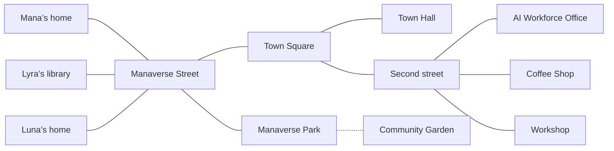

# Manaverse town layout

Solid lines are current connections. Dotted lines are planned routes.

## First expansion

Keep Mana’s home, Lyra’s library, and Luna’s home in their current order. The park keeps its street entrance. Continue from the far end of Manaverse Street through Town Square to a second street.

Give the AI Workforce Office, Coffee Shop, and Workshop their own entrances on the second street. The office gives the Mana Studio workforce a place to meet and work. The coffee shop is the regular hangout for Git and Office Coffee, as described in Aishi’s Future Vision. Connect the Community Garden to the park by a footpath.

The legacy roadmap also lists visitor houses. Keep room for them in a later residential expansion as more residents arrive. Lyra’s library keeps the founding note from Aishi’s Future Vision.

Town Square connects Manaverse Street to Second Street. Mana, Luna, and Lyra can walk the square and stop to chat. On Second Street, Mana can walk to each of the three doors and enter. The interiors use existing room pieces while their activities are in development. All four new locations are camera destinations in the phone map.

Town Hall uses the blue door on the right side of Town Square. It is also a camera destination in the phone map. Its notice board shows active park meetups and upcoming home or hosted visits from Mana’s plans.

## Decoration schedules

Open Town Hall’s notice board and choose **Decorations**. Add a schedule, choose its decorations, and set a start and end date. Both dates are included. **Repeat every year** uses the month and day; turn it off for a one-time range. Annual ranges can cross New Year. A February 29-only schedule appears only in leap years.

Schedules can also follow calendar event hours. Choose a provided event group or enter a specific event title. These schedules follow actual active events; date-only decoration schedules do not create gatherings or events.

Each schedule can be edited, disabled, or deleted independently. Overlapping schedules combine their selected decorations in Town Square. Existing December and event settings migrate automatically. Settings travel with room saves and backups.

The available decoration catalog is defined in `src/core/townFestivities.ts`; future decoration assets can be added to that catalog and its renderer without introducing another holiday-specific settings page.

### Arranging decorations

In **Town Hall → Notice board → Decorations**, choose **Edit layout** on a schedule. The editor previews that schedule against the full Town Square background, even when the schedule is inactive.

- Drag from the object library onto the square, or click a library item to add it.
- Drag objects to move them; use the corner handle or width/height fields to resize. Proportions are preserved by default.
- Adjust rotation, flip, opacity, layer, visibility, and locking in the inspector. The object list selects small, hidden, or overlapping pieces.
- Use grid/snapping, zoom, and background dragging to arrange the scene. Arrow keys nudge; Shift nudges further. Ctrl/Cmd+Z undoes, Ctrl/Cmd+Shift+Z or Ctrl+Y redoes, Ctrl/Cmd+D duplicates, and Delete removes the selection.
- Save layout to apply it to that schedule. Cancel preserves the previous arrangement; unsaved changes prompt before being discarded. Each schedule has its own objects, and layouts are included in room saves and backups.

These are visual decorations; their placement does not add navigation obstacles or change the town’s walking routes.

Phone message read markers are saved with room data as well. Reading a conversation or selecting **Mark all read** clears its unread badge across restarts; newly received text can raise the badge again.

Editor shortcuts also include Ctrl/Cmd+C, X, and V for an object clipboard shared between schedule editors during the current app session, and Ctrl/Cmd+S to save. Copy/paste in text fields keeps its normal behavior. The round handle rotates the selected object around its base; holding Shift (or enabling Snap) snaps rotation to 15° increments. Square bracket keys rotate by 15° as well. Escape cancels an unfinished gesture without adding it to undo history. **Find selected** (F) centers the view, and the inspector provides reset rotation and front/back layer buttons. Each completed mouse gesture is one undo step.

## Town weather and shelter

Open the phone’s **Weather** app to choose automatic weather, clear skies, or rain. Automatic weather is local to Manaverse, follows the town calendar in stable three-hour blocks, and does not use a real-world weather service. Manual choices, intensity, and effect visibility persist with room saves and backups.

Rain appears on Manaverse Street, Town Square, Second Street, and the park. Gentle and steady settings change the visuals. Reduced-motion preferences show still rain, and the effects can be hidden without changing behavior.

Mana keeps indoor appointments. Outdoor free-time stops favor shelter: Town Hall from the square, the café from Second Street, or home from the residential street and park. She stays indoors if she is already sheltered. Luna and Lyra avoid new outdoor outings, finish the current walking segment, then use normal exits to return home; residents already in the café or library can wait there. Park residents leave their benches and walk to the exit. Their normal schedule can resume once the weather clears.

Outdoor gatherings and park meetups pause during rain. A canceled park meetup records the weather reason without recording a completed activity. Indoor café meetups remain possible. Event dates and hours stay on the calendar, and passing through the rainy square does not add guestbook attendance. Weather facts are included in scene dialogue context.

When Pet Bot is accompanying Mana, she favors bringing it back home during rain rather than leaving it outside another building; both use their normal walking routes and home-return behavior.

### Snow and seasonal automatic weather

Snow uses two depths of drifting flakes on all four outdoor maps, with gentle and steady intensity. The floor and walking routes stay the same. Reduced-motion preferences show still flakes; hiding weather effects preserves the current weather behavior.

Gentle snow allows ordinary outdoor activities, park meetups, and holiday gatherings. Steady snow shares the existing indoor-shelter behavior, including normal doorway travel and bringing Pet Bot home when accompanying Mana. Scene dialogue receives the snowfall and shelter context without inventing snow-related activities.

Automatic weather now varies by town season. Per three-hour block, the chances are spring 35% rain, 10% fog, 20% breeze; summer 20% rain, 5% fog, 25% breeze; autumn 30% rain, 20% fog, 25% breeze; winter 45% snow, 10% rain, 15% fog, 10% breeze. Clear weather covers the remainder. Blocks remain stable across refreshes and restarts. Snow occurs automatically only in winter. The default town calendar has winter in December–February; **Phone → Weather → Town seasons** also supports June–August winter. These are fantasy-town seasons rather than a claim about the user’s location.

Manual clear/rain/snow choices remain available for testing, including snow outside winter. Automatic is the default. They can be removed after weather testing is complete.

### Fog and breezy weather

Fog and breeze are available in the phone’s testing overrides and seasonal automatic mode. Fog uses two drifting mist layers while retaining visible paths and doors. Breezes carry a few leaves across the scene, with warmer leaf colors in autumn. Gentle settings keep the effects light; steady settings add denser fog or more leaves.

Neither fog nor breeze interrupts outdoor activities or gatherings. Both share weather dialogue context, persisted settings, the effects toggle, and static reduced-motion variants. All effects remain inside outdoor maps and do not intercept character or door controls.

### Weather transitions and local ambience

Outdoor weather layers crossfade over about 1.4 seconds, including a fade to clear skies or hidden visual effects. Inactive layers pause their animations. Reduced-motion preferences disable fades and particle animation.

**Phone → Weather → Ambient sound** provides a weather-sound checkbox and independent volume slider. Settings persist with room saves and backups. Visual effects and sound can be controlled independently. Rain and wind textures are synthesized locally with Web Audio filtered noise; no audio downloads, samples, licensing dependencies, or network requests are involved. Rain has a hiss with soft wind modulation, breezes use slowly varying wind, snow uses faint wind, and clear skies/fog stay quiet.

Audio starts after user interaction, with **Enable ambience** available if browser playback needs another gesture. Changing weather and moving indoors adjusts gains smoothly. Indoor ambience is quieter and low-pass filtered. Leaving the room view, opening its editor, or hiding the app suspends the audio context; unmounting releases its sources and context. Shelter decisions still use the actual current weather rather than the fading visual layer.

### Winter scenery

Winter adds map-aligned snow caps to roof ridges, awnings, benches, shrubs, and selected path edges across Manaverse Street, Town Square, Second Street, and the park. These SVG surface accents sit over the existing artwork; buildings, character positions, walkable routes, and collisions are unchanged. Masks use the shared doorway coordinates to keep entry/exit approaches clear. The scenery remains behind characters and decorations and does not intercept input.

Snow caps remain throughout the town’s winter season, including clear days. The manual **Snow** override also previews winter scenery outside winter for testing. **Phone → Weather → Seasonal scenery** controls the landscape accents separately from falling weather effects and ambience. The preference persists with room saves/backups. Season changes fade the overlays; reduced-motion preferences switch without animation.

### Autumn scenery

Autumn adds warm foliage and stable fallen-leaf piles beside paths and along selected roof edges on all four outdoor maps. Feathered masks recolor the existing foliage artwork, preserving its detail. The overlays share winter’s doorway clearance masks and leave navigation unchanged. Breeze weather still supplies the moving leaves independently.

All seasonal scenery follows the town calendar and the Seasonal scenery preference. The manual Snow preview takes precedence over other seasons.

### Spring scenery

Spring adds pastel flower clusters in existing planters and planted borders on all four outdoor maps. Stable placements do not change on refresh or weather checks. Flowers use the same doorway masks, lighting, visibility preference, and season transitions as the other scenery. Paths, collisions, and decorations remain unchanged. In November, the June–August winter calendar gives a spring preview; restore the preferred calendar afterwards.

### Summer scenery

Summer uses larger eight-petal golden, apricot, cream, and coral daisies in the same established planted borders across all outdoor maps. Spring and summer share a flower renderer and doorway masks. Each season selects only its own scenery; the Snow test override selects winter. Summer follows June–August in the default northern calendar and December–February in the southern calendar. No scenery changes navigation or creates new obstacles. Seasonal scenery, lighting, and reduced-motion preferences apply as with the other seasons.

**Temporary testing:** Phone → Weather → Scenery preview selects Automatic, Spring, Summer, Autumn, or Winter without changing the clock, actual weather, schedules, shelter behavior, or season-based outfits. Explicit scenery previews take precedence over the Snow test override. Seasonal scenery must be enabled. Choose Automatic to return to normal selection. The preview is session-only and is excluded from saved settings and backups; reopening the app resets it.

### Phone quiet hours and visit wording

Automatic phone invitations, AI text generation/publication, and replies pause during the shared 22:00–06:00 sleep window in the town timezone. Mana’s daytime sleep also pauses messaging. Pending drafts and replies remain available after waking; a reply timer or AI request finishing across bedtime cannot publish overnight. This also applies when Mana skips bedtime, since her contacts still sleep. Invitation prompts and validation distinguish a proposed visit from a recorded completed visit; an invitation cannot claim someone already stopped by.

### Occasional weather reactions

Mana and registered residents share a single weather-reaction controller across all maps. After a 30-second warmup, it may request one short line from the character’s AI about the actual weather, or visible seasonal scenery on clear outdoor days. Only a character recorded in the current map with a visible, awake, unheld sprite is eligible. Lines attach to that existing sprite and follow it while walking. Indoor prompts explicitly distinguish shelter from exposure; seasonal previews are visible scenery, not a changed date. Other characters in the map are not evidence of a shared activity or Aishi being present.

There is at least 90 seconds between reactions town-wide, five minutes per character, and fifteen minutes before that character can react to the same weather/scenery topic again. Changing maps does not reset these cooldowns. Existing conversations, activity speech, invitations, editing, hidden views, model unavailability, and the 22:00–06:00 sleep window suppress new reactions. Pending lines are discarded when location, weather, activity, or eligibility changes. Existing six-second speech-bubble timing applies. Weather reactions are observations, not recorded activities or memories, and do not change schedules, routing, shelter behavior, or saved data. The earlier uncapped immediate Mana weather-change reaction is replaced by this controller.
